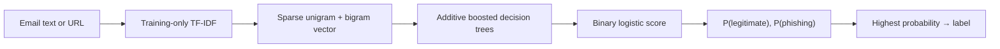
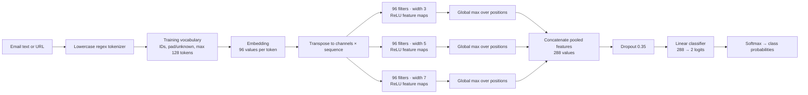

# PhishGuard Model Architectures and Prediction Flow

## Scope and implementation source

This report documents the five architectures implemented by the reproducible
benchmark in [`../../ml/benchmark_models.py`](../../ml/benchmark_models.py),
and the settings recorded by
[`run_manifest.json`](./run_manifest.json) and the per-model result files in
this directory. These are the benchmark text classifiers; they are not all
the models used by the live application. The checked-in production Node.js
classifier is primarily heuristic, and the optional Python inference service
described elsewhere in the project is not present in this checkout.

The benchmark trains a **separate binary classifier for each dataset**. It
does not train one classifier on all three datasets and then evaluate that
single model on each. There are five architectures times three datasets, for
15 independently trained model/dataset runs.

## Data presented to the models

All five models receive text and predict one of two labels:

| Dataset | Model input | Positive label |
|---|---|---|
| CEAS_08 | Sender, subject, body, and URL field joined as text | `phishing` (`1`) |
| URLData | The URL string | `phishing` (`bad`, `1`) |
| PhishTank evaluation set | Verified, online PhishTank URL strings plus clean URLData URL strings | `phishing` |

PhishTank does not contain benign examples. For its binary evaluation, the
benchmark constructs a mixed-source set: verified and online PhishTank rows
are positive, while distinct `urldata.csv` rows labelled `good` are negative.
Clean URLs whose hostname occurs in the PhishTank feed are excluded, and URLs
are grouped by hostname for splitting. Consequently, PhishTank results are
**not a PhishTank-only or independent-domain generalization measurement**.

The completed benchmark used seed 42 and a reproducible, class-balanced cap
of 1,000 records per dataset. Each dataset's sample was split into 600 training,
200 validation, and 200 test records. Email duplicate groups and URL hostnames
are kept within a single split. The same test records are used by all five
models within a dataset. The report therefore describes the saved capped,
one-epoch comparison—not full-corpus training.

## Shared prediction convention

Each model produces two class scores or probabilities in the order
`[legitimate, phishing]`. XGBoost uses `predict_proba`; the neural models apply
softmax to their two output logits. The selected label is the class with the
larger probability (equivalent to a 0.5 threshold for this two-class output).
Prediction exports include both probabilities and confidence, defined as the
larger of the two.

## XGBoost: word and phrase features plus boosted trees

### Input representation

`TfidfVectorizer` fits only on the training text. It creates a sparse numeric
vector from unigrams and bigrams, discards terms occurring in fewer than two
training documents, applies sublinear term frequency, strips Unicode
diacritics, and is capped at 100,000 features. Validation and test strings are
transformed using that fitted training vocabulary; they do not influence which
features are learned.

Thus, for CEAS_08, tokens may come from the sender, subject, body, or included
URLs. For URLData and the PhishTank evaluation set, the features come from the
URL string. This is a bag-of-terms representation: it retains term and
two-term presence/weight information, but does not encode a learned word order
or contextual embedding.

### Classifier and output

`XGBClassifier` uses a binary logistic objective and histogram tree builder.
The configured maximum is 500 boosting rounds, with maximum tree depth 6,
learning rate 0.08, row and feature subsampling of 0.85, and class weighting
derived from the training split. Validation log loss and classification error
are evaluated each round; early stopping uses patience 1. The saved run stopped
at best rounds 37 (CEAS_08), 53 (URLData), and 89 (PhishTank evaluation set).
Those counts are specific to this seed, data sample, and run configuration.

The trees contribute additive scores which are converted by the binary
logistic objective to class probabilities. This benchmark's XGBoost model is
a text classifier; it is not the separate synthetic attachment XGBoost model
in `ml/artifacts/`.

## BERT: pretrained bidirectional Transformer encoder

The benchmark loads `google-bert/bert-base-uncased` and fine-tunes it for
binary sequence classification. The tokenizer converts the same raw text used
by XGBoost into WordPiece token IDs and an attention mask. Inputs are truncated
to, or padded to, 128 tokens. BERT's 12 Transformer encoder layers use
bidirectional self-attention; the saved checkpoint configuration has hidden
size 768 and 12 attention heads.

The benchmark uses the Hugging Face BERT sequence-classification model. Its
first-token representation passes through dropout (`0.1`) and a linear
`768 → 2` classifier. That two-class classification layer is newly
initialized, not a pretrained phishing head; the pretrained encoder weights
are fine-tuned on the dataset training split. Training uses weighted
cross-entropy with balanced class weights, AdamW at learning rate `2e-5`,
batch size 16, and one epoch.
The saved checkpoint revision is
`86b5e0934494bd15c9632b12f734a8a67f723594`.

## RoBERTa: pretrained robustly optimized Transformer encoder

The benchmark loads `FacebookAI/roberta-base`. Its tokenizer encodes the same
dataset text as BERT, but uses RoBERTa's byte-level BPE vocabulary rather than
BERT WordPiece. Inputs are padded/truncated to 128 tokens with an attention
mask. The saved model configuration has 12 Transformer layers, hidden size
768, and 12 attention heads.

The Hugging Face RoBERTa sequence-classification head takes the first-token
representation through a dense `768 → 768` layer, `tanh` activation, dropout
(`0.1`), and an output projection `768 → 2`. The classification head is newly
initialized while the pretrained encoder is fine-tuned. Training uses
balanced weighted cross-entropy, AdamW at `2e-5`, batch size 16, and one
epoch. The saved checkpoint revision is
`e2da8e2f811d1448a5b465c236feacd80ffbac7b`.

## CNN: convolutional n-gram feature extractor

### Convolution, filters, and feature maps

The CNN uses the benchmark's own lowercase regex tokenizer. A vocabulary is
built **from the training texts only**, keeping up to 50,000 tokens; ID 0 is
padding and ID 1 is unknown. Each example is truncated to the first 128 tokens
and right-padded to length 128. A trainable embedding maps each token ID to a
96-dimensional vector. It is learned from scratch; this CNN does not use a
pretrained embedding model.

For a batch, the embedded sequence has shape
`[batch, 128 positions, 96 embedding channels]`. The implementation transposes
it to `[batch, 96 channels, 128 positions]` for three parallel 1-D convolution
branches. Each branch has 96 learned filters, with widths 3, 5, and 7
respectively, and padding 1, 2, and 3. Each filter slides over neighboring
token embeddings, producing a feature map that scores a learned local pattern
at every sequence position. A ReLU is applied to each map.

### Pooling, flattening, and classification

Each feature map is reduced by a **global max over its 128-position axis**.
This keeps the strongest match for each filter, regardless of where that
pattern appeared. Each branch therefore produces 96 pooled values; the three
branches are concatenated into a 288-value representation.

There is **no explicit flatten operation over the complete feature maps** in
this implementation. Global max pooling first removes the sequence dimension;
concatenating the pooled branch vectors forms the fixed-size classifier input.
After dropout (`0.35`), a linear layer maps 288 features to two logits. Softmax
converts them to legitimate and phishing probabilities.

The CNN uses post-padding but does not pass a padding mask into its
convolutions or exclude padded positions from global max pooling. It therefore
uses the implementation's raw fixed-length tensors, not a masked CNN variant.

Training uses balanced weighted cross-entropy and AdamW at learning rate
`0.001`, batch size 128, and one epoch.

## LSTM: bidirectional sequence encoder

The LSTM shares the CNN's training-only regex vocabulary, 96-dimensional
trainable embeddings, 128-token input limit, and right-padding convention.
Its recurrent layer is a single bidirectional LSTM with 96 hidden units in
each direction and `batch_first=True`. No pretrained embeddings are used.

The forward representation is taken from the output at the last non-padding
token. The backward representation is taken from the output at sequence
position zero. Concatenating the two gives a 192-value sequence representation.
Dropout (`0.35`) and a linear `192 → 2` classifier produce logits, followed by
softmax probabilities.

Although the final representation selects the last non-padding forward output
and the position-zero backward output, the LSTM does not use packed sequences
or a padding mask during recurrent computation.

Training uses balanced weighted cross-entropy and AdamW at `0.001`, batch size
128, and one epoch.

## How the architectures are applied to the three datasets

| Architecture | CEAS_08 email | URLData | PhishTank evaluation set |
|---|---|---|---|
| XGBoost | TF-IDF over sender, subject, body, and URL text | TF-IDF over URL text | TF-IDF over PhishTank positives and URLData clean negatives |
| BERT | WordPiece-tokenized email text | WordPiece-tokenized URL | WordPiece-tokenized mixed-source URL sample |
| RoBERTa | Byte-level BPE email tokens | Byte-level BPE URL tokens | Byte-level BPE mixed-source URL sample |
| CNN | Learned token embeddings and local n-gram filters | Learned token embeddings and local URL patterns | Learned token embeddings on mixed-source URL strings |
| LSTM | Learned token embeddings and bidirectional sequence context | Learned token embeddings and URL-token order | Learned token embeddings on mixed-source URL strings |

For every cell, the benchmark creates a new model instance and trains it on
that dataset's training split. A URL trained on URLData is not reused as the
PhishTank model. The same grouping-aware held-out records are evaluated across
the five architectures for each dataset.

## Training, validation, and output details

- Split: grouped stratified 60% train / 20% validation / 20% test, using seed 42.
- Evaluation target: phishing is the positive class; outputs include a
  two-class confusion matrix ordered legitimate then phishing.
- Neural training: one epoch for this saved run; the best checkpoint is chosen
  by validation loss. The reported training accuracy for neural models is the
  in-batch, pre-update accuracy accumulated during training.
- XGBoost training: up to 500 boosting rounds, selected via validation early
  stopping. Its training accuracy is evaluated per boosting round.
- Prediction: two-class probabilities are exported for every held-out sample.
  Correct and misclassified examples are available in
  [`../predictions/`](../predictions/).

## Interpretation limits

1. The saved comparison caps each dataset at 1,000 class-balanced examples;
   it is not a full-dataset performance estimate.
2. The PhishTank binary set combines phishing URLs from PhishTank with clean
   URLs from URLData. Its unusually strong scores should not be read as
   PhishTank-only validation or as proof of deployment performance.
3. CNN and LSTM are small, from-scratch models trained for one epoch here;
   BERT and RoBERTa start from pretrained general-language checkpoints and
   receive one fine-tuning epoch. The training budgets are deliberately
   documented because the architectures do not have equivalent pretraining.
4. The benchmark models are experimental text classifiers and are distinct
   from the live application's Node.js heuristic classifier and separate
   attachment-scanning path.
